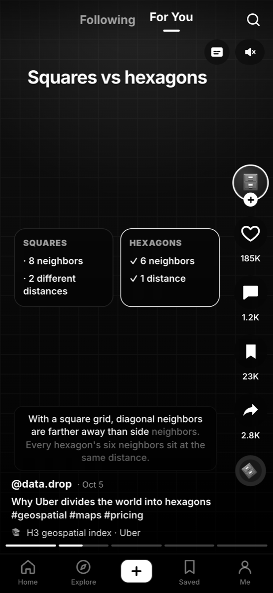
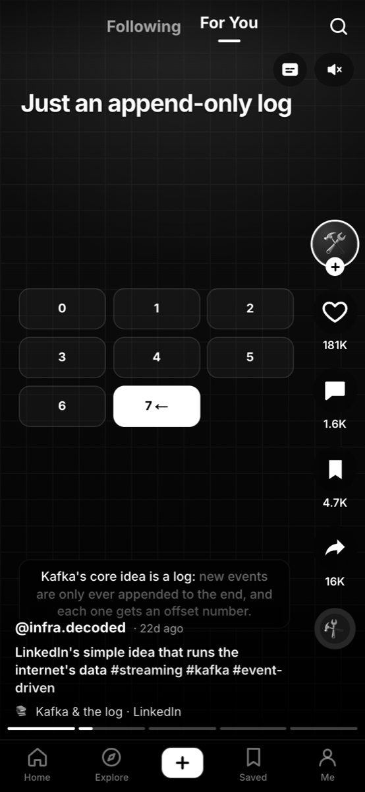
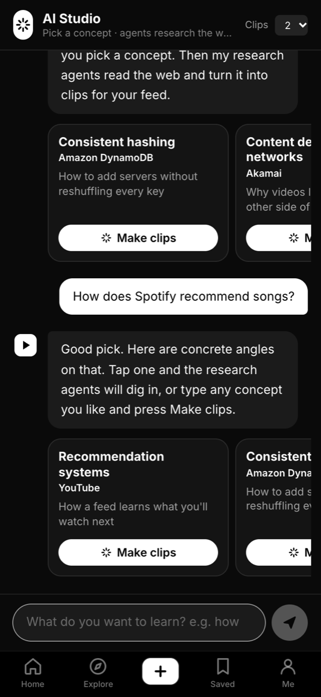
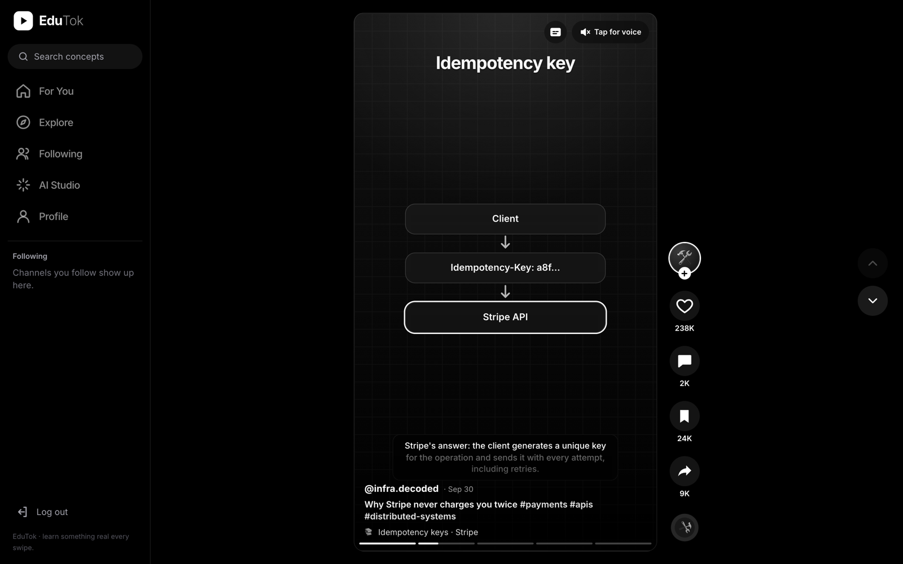
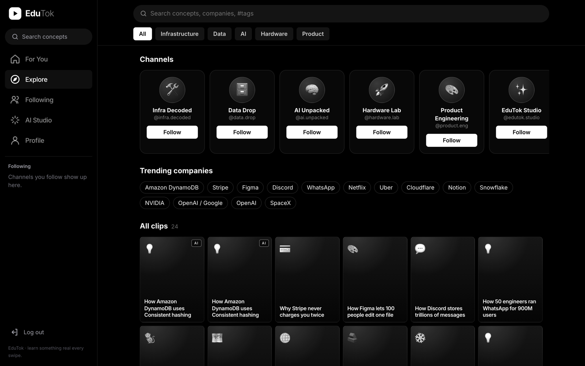
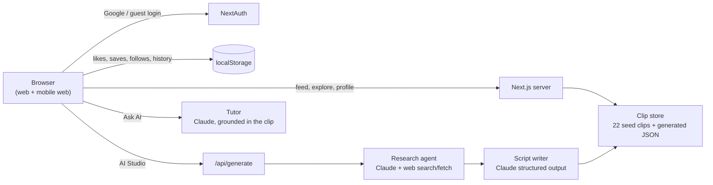
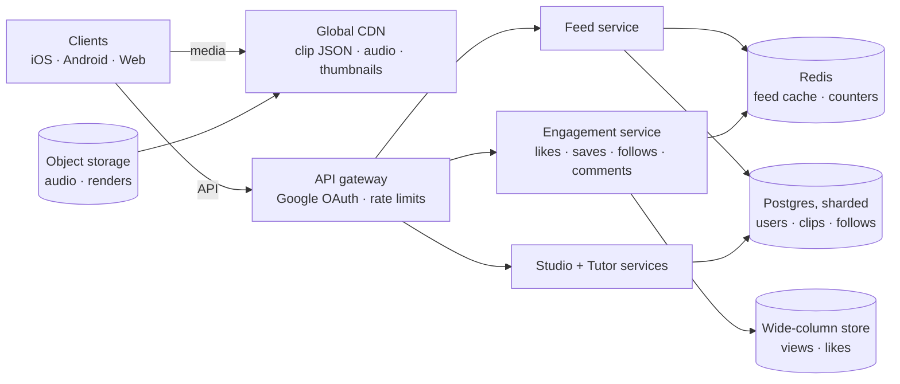
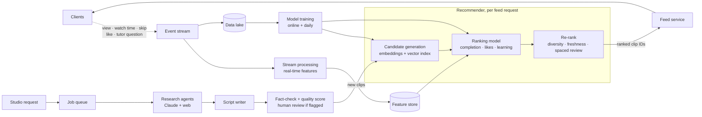

# EduTok

A short-form, swipeable learning feed. Instead of random videos, every clip is a 45–75 second explainer on the engineering behind great startups and technological breakthroughs, like Stripe's idempotency keys, Discord's message storage or SpaceX's booster landings. An **AI Studio** chatbot lets you pick any concept. Research agents then read the web and script new clips straight into your feed.

The goal: a feed people can open instead of a social app that doesn't teach them anything.

<p align="center">
  
  &nbsp;
  
  &nbsp;
  
</p>

<p align="center">
  
</p>

<p align="center">
  
</p>

## Features
- **Vertical snap feed** (For You / Following): tap to pause, double-tap to like, keyboard ↑/↓, a segmented scrubber, loop playback, and a mobile layout with a bottom nav and top tabs.
- **Clips without video files.** Each clip is a set of animated scenes (titles, bullet builds, process flows, stats, comparisons, code, grids) with optional voice narration (Web Speech API) and karaoke-style captions.
- **Action rail.** Follow, like, comment, save and share (copy link, X, LinkedIn, WhatsApp, email, native share, or download study notes as Markdown).
- **Comments double as Q&A.** Toggle *Ask AI* and the tutor answers questions about that clip, grounded in its script.
- **AI Studio.** A chat guide suggests concrete concept + company pairings. *Make clips* runs the agent pipeline with live progress:
  1. **Research agent:** Claude with server-side web search and web fetch, preferring engineering blogs and papers. It returns a summary, facts and sources.
  2. **Script writer:** Claude with structured outputs turns the notes into 5-scene clips.
  3. **Publisher:** saves the clips and boosts them in your For You feed.
- **Explore** (search, categories, channels, trending companies), **channel pages**, and a **profile** with Liked, Saved, Made with AI and Watched tabs plus learning stats.
- **Google sign-in** via NextAuth, plus a guest login so it works before OAuth is configured.
- 22 hand-written launch clips, each citing its primary sources.

## System design

### How it works today
A single Next.js app. Clips are not video files: each one is a list of scenes (caption, narration, visual) stored as JSON, and the player animates them in the browser. That keeps a clip around 5 KB instead of several MB of video.



The Claude agent path is implemented; so far the offline path (Wikipedia research + template writer) is what has been run end to end.

### How it scales to millions of daily users
The target architecture follows the pattern large short-video feeds use: serve content from the edge, log every interaction as an event, and let a recommender trained on those events (in near real time) decide what comes next. ByteDance described its real-time training approach publicly in the [Monolith paper](https://arxiv.org/abs/2209.07663).

**Serving path.** Every swipe is a cheap read: the clip itself comes from the CDN, and the API only returns which clip IDs to show next.



**Learning loop and content pipeline.** Every interaction becomes an event, events become features and training data, and the recommender picks the next clips. New AI-made clips enter the same candidate pool once they pass fact-checking.



| Concern | Design choice | Why |
|---|---|---|
| Serving the feed | Clips are small JSON and cached at the CDN; the feed service returns only an ordered list of IDs | Most reads never touch the database |
| Ranking | Two stages: cheap candidate retrieval from embeddings, then a heavier model on a few hundred candidates | Scoring the whole catalog per request doesn't scale |
| Learning from users | Every view, skip and watch time goes to the event stream; features update within seconds | The feed adapts during a session, the core short-video loop |
| Education signal | Ranking also optimizes for learning (tutor questions, quiz answers, spaced review), not just watch time | Our goal is understanding, not only engagement |
| Writes at volume | Likes and views go to a wide-column store and Redis counters, aggregated asynchronously | Counters on hot clips would otherwise lock rows |
| Generating content | Clips are made once by a queued agent pipeline, fact-checked, then watched by everyone | AI cost is per clip, not per viewer |
| Rough load at 1M daily users | ~50M clip views and ~250M events/day; ~600 views/s average, a few thousand at peak | Comfortable for a CDN plus a horizontally scaled stateless API |

The path from today's prototype to the first production version is in [docs/PRODUCTION.md](docs/PRODUCTION.md).

## Run it
```bash
npm install
cp .env.example .env.local   # fill in what you have
npm run dev                  # http://localhost:3000
```

### Google sign-in
1. Google Cloud Console → APIs & Services → Credentials → *Create OAuth client ID* (Web application).
2. Authorized redirect URI: `http://localhost:3000/api/auth/callback/google`
3. Put `GOOGLE_CLIENT_ID`, `GOOGLE_CLIENT_SECRET` and a `NEXTAUTH_SECRET` (`openssl rand -base64 32`) in `.env.local`.

### AI agents
Set `ANTHROPIC_API_KEY` in `.env.local` to enable the Claude agents (model `claude-opus-5-5`, with server-side refusal fallbacks enabled). Without a key, everything still works in **offline mode**:
- Research uses the Wikipedia API. Sentences are quoted with attribution; Wikipedia text is CC BY-SA.
- A template writer scripts the clip.
- The chat guide and tutor use simple keyword matching.

Generate clips from the terminal:
```bash
npm run agent -- "Consistent hashing" "Amazon DynamoDB" 2
```

## Project layout
| Path | What |
|---|---|
| `app/` | Next.js App Router pages (feed, explore, studio, profile, channel, clip, login) and API routes |
| `components/player/` | Scene player: timing, narration, captions, visuals, action rail |
| `components/feed/` | Snap feed, comments/Q&A sheet, share sheet |
| `components/studio/` | AI Studio chat + agent progress UI |
| `lib/agents/` | `research.ts`, `writer.ts`, `guide.ts`, `tutor.ts`, `pipeline.ts` |
| `content/` | Launch clips, channels, starter concept ideas |
| `lib/user-state.tsx` | Likes, saves, follows, comments, watch history (localStorage for now) |
| `data/generated/` | AI-made clips as JSON (stand-in for the database) |

## Roadmap
- Database for users, clips and engagement, replacing localStorage and JSON files
- Data collection + ML pipelines: a real recommender, and quality scoring of generated clips
- Rendered video/audio export, creator uploads, moderation and fact-check review for AI clips
